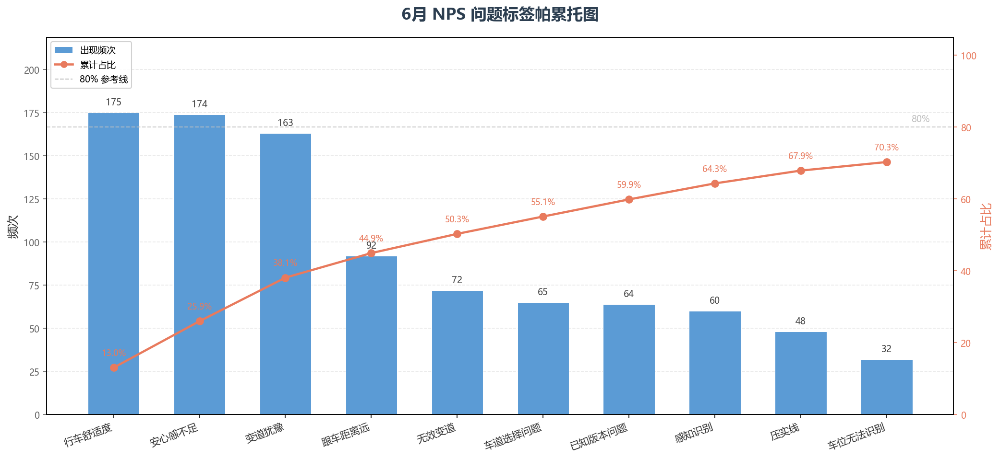
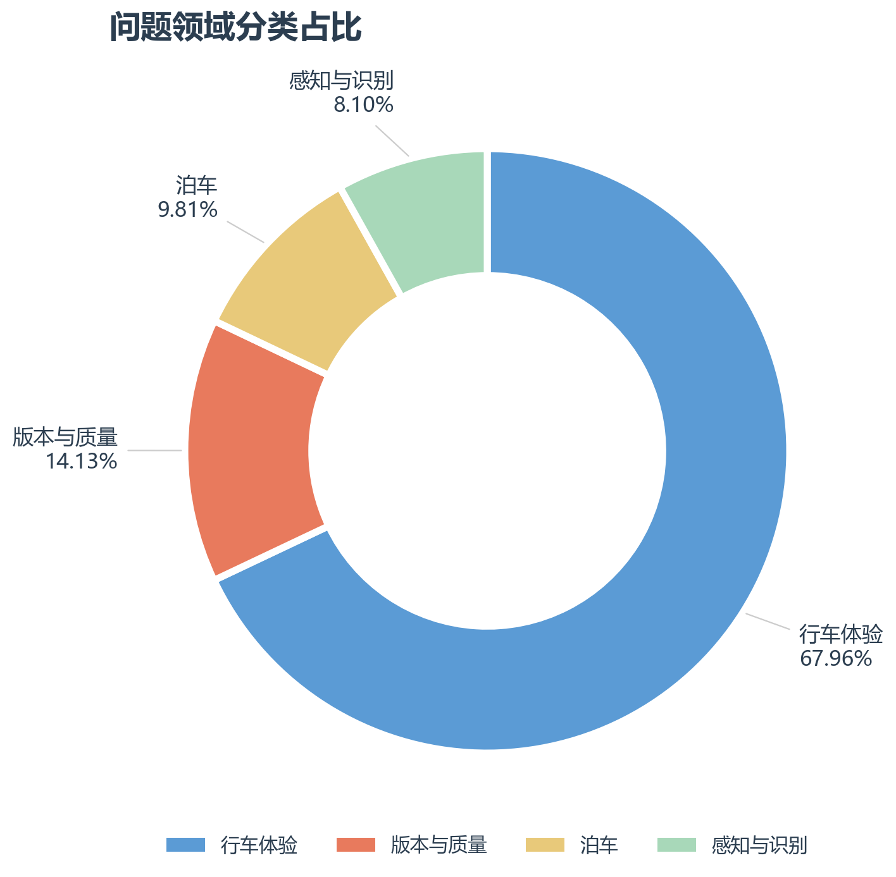

# 6月NPS\_Top10问题

> **数据范围：** 6月NPS解决方案分类表全部1,568条样本 \| **剔除三类：** 无场景（162）\+ 非智驾（25）\+ 需确认场景（36） \| **有效问题合计：** 1,345条 \| **占比口径：** 以1,345条有效问题为分母 \| **细分类别：** 41类

## Top 10 问题排名

|**排名**|**问题标签**|**频次**|**占比**|**累计占比**|**领克**|**极氪**|**总结性话语**|
|---|---|---|---|---|---|---|---|
|1|**行车舒适度**|175|13\.01%|13\.01% |41|131|用户普遍反馈智驾行车时加减速突兀、刹车过急，整体乘坐平顺性不足，体感与人类驾驶差距明显。|
|2|**安心感不足**|174|12\.93%|25\.95%|39|129|用户反映智驾在变道、匝道、高速超车等场景下处理激进或决策不当，频繁触发危险操作，引发强烈不安全感。|
|3|**变道犹豫**|163|12\.12%|38\.07%|24|139|用户吐槽智驾变道迟缓不果断，该变道时龟速跟车，导致通行效率降低，尤其在高速和拥堵场景下体验差。|
|4|**跟车距离远**|92|6\.84%|44\.91%|4|88|用户普遍认为智驾默认跟车距离过大，尤其在拥堵和低速场景下频繁被加塞，影响通行效率，期望可自定义或自适应调整。|
|5|**无效变道**|72|5\.35%|50\.26%|14|58|用户反馈智驾变道策略不合理，包括高速上乱变道、无故变道、识别桩筒后无效变道，导致行驶轨迹混乱。|
|6|**车道选择问题**|65|4\.83%|55\.09%|10|54|用户反映智驾在多车道场景下车道选择不优，常见如匝道变道晚、走错车道、车道识别错误、不能按导航车道行驶。|
|7|**已知版本问题**|64|4\.76%|59\.85%|61|3|用户反馈OTA升级后自动泊车等功能出现退化或Bug，如识别刹车误触发泊出、自动泊车失效等，影响功能稳定性。|
|8|**感知识别**|60|4\.46%|64\.31%|16|43|用户反映智驾对维修路段车道线、红绿灯、障碍物、复杂路口等场景识别能力不足，导致误刹或急停。|
|9|**压实线**|48|3\.57%|67\.88%|7|41|用户反映智驾变道时频繁压实线、跨越车道线，尤其在高速和匝道场景下影响安全合规性。|
|10|**车位无法识别**|32|2\.38%|70\.26%|19|13|用户反馈自动泊车对车位识别能力弱，需挂倒挡后才显示车位，复杂车位泊车不成功。|

> **累计占比说明**：基于6月单月1,345条有效标签数据，按频次从高到低逐行累加各标签占比所得。用于衡量头部集中度——累计占比越高，说明问题越集中在少数标签上。

## 标签分类概述

|**问题领域**|**涉及标签**|**合计次数**|**占比**|
|---|---|---|---|
|行车体验|行车舒适度、安心感不足、变道犹豫、跟车距离远、无效变道、车道选择问题、压实线、系统误刹、车速控制不合理、效率低、车道不居中、起步速度慢、跟车距离近、不避让大车、仲裁逻辑、D2D切换不丝滑|914|67\.96%|
|版本与质量|已知版本问题、功能缺失、偶发问题、ADAS未启动、智驾降级/退出、操作便利性问题、硬件问题、客户不知道设置项、行车卡死|190|14\.13%|
|泊车|车位无法识别、泊车不准、泊车卡死、泊车失效、泊车剐蹭、泊车速度慢、无法完成掉头、遥控泊车性能不足、泊车启动慢、ETC识别问题、泊车顿挫、泊车原地打方向盘|132|9\.81%|
|感知与识别|感知识别、系统报警相关、闯红灯、未知原因速度变化|109|8\.10%|

## 关键洞察

### 1\. 极氪用户吐槽集中度远高于领克

Top 10 问题中，极氪样本量全面领先领克。典型如：

- **跟车距离远**：极氪 88 vs 领克 4（22:1）

- **变道犹豫**：极氪 139 vs 领克 24（5\.8:1）

- **无效变道**：极氪 58 vs 领克 14（4\.1:1）

反映极氪用户对智驾的效率和体验类问题反馈更强烈，建议优先从极氪用户视角优化通行效率和变道策略。

### 2\. 领克"已知版本问题"占比异常突出

已知版本问题 64 条中 **领克占 61 条（95%）**，远高于领克总样本占比。典型反馈包括"OTA升级后自动泊车变差""更新后泊车识别刹车误触发泊出""自动泊车失效"等，需重点跟进领克 OTA 版本的稳定性回归问题。

### 3\. Top 3 标签高度同质化：均指向"行车体验"

行车舒适度（175）\+ 安心感不足（174）\+ 变道犹豫（163）合计 512 条，占比 **38\.07%**。三者均围绕行车过程中的平顺性、安全感和决策果断性，是用户感知智驾能力最核心的三个维度，建议作为一体化体验优化方向。

### 4\. "跟车距离远"持续成为高频可优化点

6月该标签 92 条中极氪占 88 条（96%），与5月趋势一致。用户期望"可自定义跟车距离"或"拥堵场景自适应缩短"，这是一个相对低成本、高感知的优化切入点。

### 5\. 泊车类问题呈现品牌分化

- **领克**：已知版本问题（61条）\+ 车位无法识别（19条），集中指向 OTA 稳定性与识别能力

- **极氪**：跟车/变道/车道选择类问题占主导，泊车问题相对较少

---

数据来源：[NPS解决方案分类表](https://qianli-drive.feishu.cn/wiki/PDBmwkQR5i1TTJknetwcCtlCnBh?table=tblCMOlPg2bTdvz3&view=vewmolHfH9&sheet=F5U71I)

